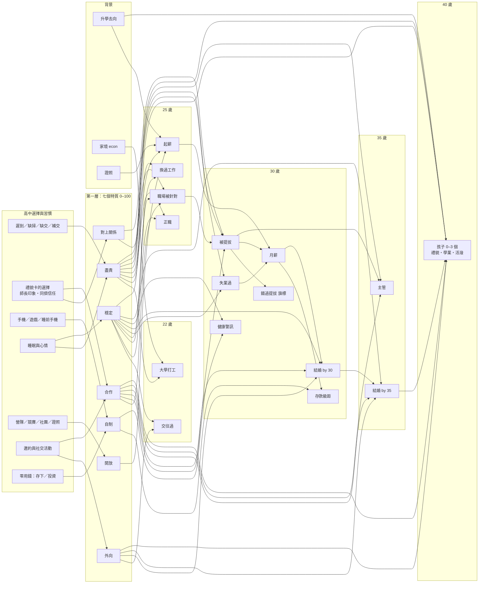

# 人生模型（原型）

> 狀態：**原型，尚未接進遊戲畫面與結局**。這份文件給老師檢視：小小的日常選擇，如何粗略地影響 22／25／30／35／40 歲的人生輪廓。
> 重點是「關係明確」而非「預測準確」：每一條箭頭都有方向、強度和白話理由，數字全部放在 `data/lifesim.json`，改那一個檔案就能調整。隨機性保留：同樣的特質，每次抽出的人生仍會不同。

程式：`js/engine/lifesim.js`（純函式）、`tools/build-lifesim-ref.mjs`（產生參考母體）、`tools/lifesim-report.mjs`（產生第 5 節報告）、`tests/lifesim.test.mjs`。

## 1. 因果圖

## 2. 每一條箭頭

特質欄的 β 是「該特質比典型高一個單位（25 點）時，事件的 logit 增加多少」。粗略換算：機率在 30% 左右時，β = 0.3 約讓機率增加 6 個百分點，β = 0.45 約 9 個百分點，β = 0.8 約 15 個百分點。特質比典型低就反向。

| 從 | 到 | 方向 | 強度 β | 白話理由 |
| --- | --- | --- | --- | --- |
| 盡責 | 大學打工 | + | 0.2 | 會排時間、守得住班表的人比較敢也比較能打工 |
| 家境吃緊 | 大學打工 | + | 0.8 | 需要自己賺生活費 |
| 外向 | 交往過 | + | 0.4 | 認識的人多，機會多 |
| 穩定 | 交往過 | + | 0.2 | 情緒穩的人比較能維持一段關係 |
| 盡責 | 25 歲正職 | + | 0.3 | 雇主看重準時與交付 |
| 穩定 | 25 歲正職 | + | 0.2 | 能撐過試用期與適應期 |
| 去向 | 起薪 | 查表 | 36,000／32,000／31,000／33,000／31,000／30,000／29,000／31,000 | 國立大學、私立大學、科技大學、國立科大、私立科大、二專五專、直接就業、重考；直接就業有證照另加 1,500 |
| 盡責 | 起薪 | + | 每 1 單位 +1,500 | 工作表現與加薪談判的長期差異 |
| 開放 | 起薪 | + | 每 1 單位 +800 | 願意學新東西、爭取機會 |
| 合作 | 職場被針對 | − | −0.35 | 職場盟友與社會支持是最一致的保護因素 |
| 穩定 | 職場被針對 | − | −0.2 | 情緒反應大較容易成為目標 |
| 對上關係 | 職場被針對 | − | −0.15 | 主管認得你、肯為你說話 |
| 穩定 | 換過工作 | − | −0.3 | 情緒起伏大較容易衝動離職 |
| 盡責 | 換過工作 | − | −0.2 | 責任感高較能把一份工作做下去 |
| 盡責 | 被提拔 | + | 0.25 | 交付可靠才有人敢交給你更多 |
| 對上關係 | 被提拔 | + | 0.20 | 升遷需要有人看見與背書 |
| 合作 | 被提拔 | + | 0.20 | 同事支持、能帶人 |
| 25 歲被針對 | 被提拔 | − | −0.4 | 被排擠者較難拿到機會 |
| 被提拔＝否，且對上關係或合作低於 40 | 錯過提拔（旗標） | 敘事用 | — | 供結局寫「有人被看見、你被略過」；不影響機率 |
| 盡責 | 失業過 | − | −0.4 | 被資遣或自離的風險 |
| 穩定 | 失業過 | − | −0.2 | 同上 |
| 被提拔／失業過 | 30 歲月薪 | + ／ − | ×(1.25 +0.15／−0.10) | 起薪乘上成長倍率，再加雜訊 |
| 自制、月薪 | 存款級距 | + | 儲蓄率 10%＋每單位 5% | 存款約＝月薪×12×儲蓄率×5 年；少／一些／不少的門檻 25 萬、60 萬 |
| 合作 | 30 歲前結婚 | + | 0.3 | 關係經營與被接納 |
| 外向 | 30 歲前結婚 | + | 0.2 | 認識的人多 |
| 穩定 | 30 歲前結婚 | + | 0.2 | 同上 |
| 月薪高於中位 | 30 歲前結婚 | + | 0.2 | 經濟條件使成家較有餘裕 |
| 自制 | 健康警訊 | − | −0.3 | 自制差者熬夜、少運動、重複不良習慣（睡眠相關輸入已併入自制／穩定） |
| 穩定 | 健康警訊 | − | −0.2 | 壓力與睡眠 |
| 30 歲未婚 | 35 歲前結婚 | 同上 | 同上 | 條件機率讓累計約 55% |
| 被提拔 | 主管（基準） | + | 0.45 對 0.10 | 有提拔經歷較可能升主管 |
| 盡責、合作 | 主管 | + | 各 0.2 | 管理工作需要可靠與帶人 |
| 穩定 | 孩子數 | + | 每單位 +0.1（每多一個孩子的權重 ×e^0.1） | 情緒與生活穩定較有餘裕養育 |
| 合作、穩定 | 孩子「禮貌」 | + | 各 0.2×(特質−50) | 親子互動與示範 |
| 盡責、國立 | 孩子「學業」 | + | 0.2×(盡責−50)，國立大學畢業 +6 | 家庭學習環境 |
| 外向 | 孩子「活潑」 | + | 0.2×(外向−50) | 氣質部分遺傳、部分模仿 |
| 已婚／有伴 | 有孩子 | 必要條件 | — | 本模型沒伴就沒有孩子 |

## 3. 第一層：特質由哪些輸入決定

每個輸入先用參考母體的平均與標準差標準化，再加權相加；特質＝這個加權和在參考母體裡的百分位（50＝典型）。

| 特質 | 輸入（權重） | 取自遊戲的欄位 |
| --- | --- | --- |
| 盡責 | −遲到 0.3、−缺掃 0.2、−缺交 0.3、+補交 0.1、−平均睡眠債 0.2、+師長印象 0.2 | `st.att`、`st.hist[].睡眠債`、`st.stats.師長印象` |
| 合作 | +同儕信任 0.5、+知心 0.2、+合作的禮貌選擇數 0.2、−「已讀不回」次數 0.2 | `st.stats`、`st.choices`（mn_ 卡且該選項 hidden 同儕信任 > 0；選項文字含「已讀不回」） |
| 外向 | +聯繫 0.6、+社交活動數 0.3 | `st.stats.聯繫`；社交活動數＝人際／社群／社團／感情類卡中選了「聯繫增加」的選項數＋開始交往、合唱、運動會、畢業旅行、班級幹部、班際比賽等 `st.acts` |
| 穩定 | +平均心情 0.3、−心情標準差 0.3、−平均睡眠債 0.2、+平均幸福 0.3 | `st.hist` |
| 開放 | +營隊／競賽／科展／證照／社團等活動數 0.6、+理解 0.2 | `st.acts`（營、競賽、科展、科學、證照、技藝、建教、海外、推薦、課輔）＋社團中旗標＋去過營隊旗標 |
| 自制 | −平均手機 0.4、−平均遊戲 0.3、−睡前手機占比 0.2、+零用錢「存下／投資」占比 0.2 | `st.hist[].h` |
| 對上關係 | +師長印象 0.8、+嘉獎 0.2、−警告 0.2 | `st.stats.師長印象`、`st.att` |

**近似與缺口（誠實記錄）**
- 「警告」在 2000 局隨機策略的參考母體裡一次都沒出現（平均 0、標準差 0），所以該輸入暫時沒有作用；若日後遊戲讓警告出現，需重建參考母體。
- 「合作的禮貌選擇」用事件卡的 `hidden.同儕信任 > 0` 判斷；`st.choices` 只存代入後的選項文字，以樣板比對回原選項。
- 「社交活動／邀約接受」遊戲沒有單一欄位，採上表的近似。
- 「補交」本身是補救行為，與缺交有相關，因此對盡責只給小的正權重（依指定）。

## 4. 基準機率（design estimates）與待確認

全部是**設計估計**，不是統計結果。待確認（台灣：平均初婚年齡約男 32、女 30；30–34 歲未婚率約男六成、女五成；總生育率約 0.9，已婚者平均約 1.6–1.8 個孩子）。

| 事件 | 基準 | 備註 |
| --- | --- | --- |
| 大學打工 | 0.55 | 僅升大學／二專五專者計算 |
| 交往過（22 歲） | 0.55 | |
| 25 歲正職 | 0.85 | |
| 職場被針對 | 0.15 | 待確認 |
| 換過工作 | 0.45 | 待確認 |
| 30 歲前被提拔 | 0.30 | |
| 失業過 | 0.06 | |
| 30 歲前結婚 | 0.30 | 待確認：30–34 歲未婚率約男六成、女五成 |
| 35 歲前結婚（未婚者） | 0.357 | 使累計約 0.55；模擬結果 58.5%，略高 |
| 健康警訊 | 0.20 | |
| 主管 | 0.45（有被提拔）／0.10 | |
| 孩子數 0／1／2／3 | 0.10／0.30／0.45／0.15 | 已婚者平均約 1.65 個（台灣已婚者約 1.6–1.8，待確認）；整體平均 0.96，與總生育率約 0.9 相近 |
| 事件機率夾限 | 0.02–0.98 | 任何特質都不會讓事件變成必然或不可能 |

## 5. 模擬報告

> 第二版權重（2026-10-19）：被提拔、被針對、主管與孩子特質的係數調降到中等強度，避免變成算命；已婚者孩子數分佈上調到約 1.6。兩種人格是刻意走極端的腳本，差距會比一般玩家大。

模擬 3000 局（randomPolicy，種子 200001–203000），死亡 0 局不計，有效 3000 局。

**整體比率**

| 項目 | 數值 |
| --- | --- |
| 25 歲正職 | 84.4% |
| 25 歲職場被針對 | 16.8% |
| 30 歲前被提拔 | 29.8% |
| 失業過 | 6.2% |
| 30 歲前結婚 | 33.3% |
| 35 歲前結婚 | 58.5% |
| 35 歲主管 | 21.2% |
| 30 歲健康警訊 | 21.4% |
| 30 歲月薪中位數 | NT$40,408 |
| 平均孩子數（全部） | 0.96 |
| 平均孩子數（已婚者） | 1.64 |
| 孩子特質平均（禮貌／學業／活潑，共 2882 個孩子） | 52.2 ／ 51.2 ／ 50.3 |

**各特質：最高四分位 vs 最低四分位**（括號內為高減低的差，單位：百分點或 NT$）

| 特質 | 被提拔 高／低 | 被針對 高／低 | 30 歲前結婚 高／低 | 30 歲月薪中位 高／低 |
| --- | --- | --- | --- | --- |
| 盡責 | 44.1% ／ 18.1%（+26.0） | 13.6% ／ 17.5%（-3.9） | 38.3% ／ 30.9%（+7.3） | 45,183 ／ 36,998（8,185） |
| 合作 | 36.1% ／ 23.6%（+12.5） | 10.0% ／ 25.2%（-15.2） | 45.3% ／ 26.5%（+18.8） | 41,079 ／ 39,904（1,175） |
| 外向 | 27.9% ／ 28.3%（-0.4） | 16.5% ／ 18.3%（-1.7） | 41.5% ／ 27.3%（+14.1） | 40,383 ／ 40,677（-294） |
| 穩定 | 31.7% ／ 25.5%（+6.3） | 12.8% ／ 20.8%（-8.0） | 39.1% ／ 26.0%（+13.1） | 42,753 ／ 37,804（4,949） |
| 開放 | 31.6% ／ 27.6%（+4.0） | 14.5% ／ 19.5%（-4.9） | 35.6% ／ 31.1%（+4.5） | 42,976 ／ 38,149（4,827） |
| 自制 | 30.1% ／ 26.3%（+3.9） | 16.1% ／ 19.7%（-3.6） | 33.3% ／ 27.9%（+5.5） | 41,834 ／ 37,886（3,948） |
| 對上關係 | 40.7% ／ 21.9%（+18.8） | 14.5% ／ 18.8%（-4.3） | 33.7% ／ 32.0%（+1.7） | 43,332 ／ 38,687（4,645） |

- 單一特質「被提拔」高低四分位差距：盡責 26.0 個百分點（**超出預期 10–25**）
- 單一特質「被提拔」高低四分位差距：對上關係 18.8 個百分點（落在預期 10–25 內）
- 單一特質「被提拔」高低四分位差距：合作 12.5 個百分點（落在預期 10–25 內）

**兩種人格**（各 500 局、同組種子；腳本策略：mn_ 禮貌卡取師長印象＋同儕信任最高／最低的選項；其他卡好人格避開增加手機／睡前手機／遊戲的選項，壞人格優先選這類選項，其餘取第一個可選項）

| | 準時、有禮貌、不太滑手機 | 常遲到、不理人、手機重度 |
| --- | --- | --- |
| 有效局數 | 500 | 500 |
| 平均盡責 | 95.0 | 14.2 |
| 平均合作 | 91.6 | 21.0 |
| 平均外向 | 75.5 | 90.5 |
| 平均穩定 | 60.5 | 23.5 |
| 平均開放 | 83.4 | 55.9 |
| 平均自制 | 72.3 | 16.1 |
| 平均對上關係 | 94.0 | 13.9 |
| 25 歲被針對 | 7.4% | 28.2% |
| 30 歲前被提拔 | 57.8% | 15.8% |
| 失業過 | 4.0% | 12.2% |
| 30 歲前結婚 | 53.0% | 21.2% |
| 35 歲前結婚 | 78.0% | 47.2% |
| 35 歲主管 | 44.0% | 10.6% |
| 30 歲健康警訊 | 12.2% | 33.4% |
| 30 歲月薪 25%／中位／75% | 43,784 / 48,303 / 52,715 | 32,610 / 36,604 / 40,122 |
| 平均孩子數（全部／已婚） | 1.28 ／ 1.64 | 0.73 ／ 1.54 |
| 孩子禮貌／學業／活潑 | 61.3 ／ 60.2 ／ 55.0 | 39.2 ／ 43.3 ／ 58.0 |

**健全性檢查**

- 沒有伴卻有孩子：0 例（檢查 4000 人）
- 孩子數超過 3：0 例
- 事件機率範圍：0.020–0.939，超出 [0.02, 0.98] 者 0 例
- 隨機策略母體的特質中位數：盡責 47.5、合作 50.7、外向 51.4、穩定 48.0、開放 48.8、自制 48.3、對上關係 49.0
- 「被提拔」單一特質高低四分位差距：盡責 26.0、對上關係 18.8、合作 12.5（預期 10–25）

（耗時 373 秒）

## 6. 怎麼調整

所有數字在 `data/lifesim.json`。改 `traits`／`weights` 之後不需要重建參考母體；改 `traits`（輸入或權重）則要執行 `node tools/build-lifesim-ref.mjs`。

| 想要的效果 | 改哪裡 |
| --- | --- |
| 某事件整體更常見／更少見 | `weights.events.<事件>.base` |
| 某特質對某事件影響更大／更小 | `weights.events.<事件>.betas.<特質>`（β 越大越敏感；符號相反則反向） |
| 縮小「被提拔」的單一特質差距 | 降低 `被提拔` 的 `盡責`、`對上關係` β（例如 0.45→0.30、0.40→0.25），或把基準 0.30 往 0.5 靠 |
| 整體減少極端 | 增大 `weights.sdScale`（預設 25；越大，特質偏離 50 的影響越小）或收窄 `weights.clamp` |
| 薪水 | `weights.salary.start`（各去向起薪）、`perSD盡責`、`perSD開放`、`noiseSd`、`at30` |
| 存款多寡 | `weights.saving`（`base`、`perSD自制`、`bands`） |
| 孩子數／孩子特質 | `weights.kids.dist`、`perSD穩定`；`weights.kid.<禮貌|學業|活潑>` 的 `coef`、`sd` |
| 特質由哪些行為決定 | `traits.<特質>` 的輸入與權重；輸入定義在 `js/engine/lifesim.js` 的 `lifeInputs` |
| 讓「典型」重新對準 50 | 改 `traits` 或遊戲數值後，重跑 `tools/build-lifesim-ref.mjs` 並提交 `data/lifesim.json` |

重新產生報告：`node tools/lifesim-report.mjs > report.md`（約 6 分鐘），把內容貼回第 5 節。
